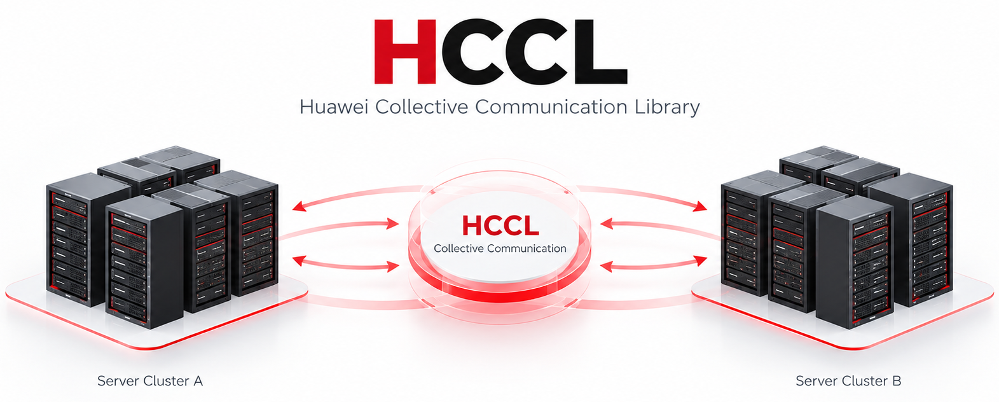

  

We are the team behind **HCCL (Huawei Collective Communication Library)** — a
high-performance communication library built for Huawei Ascend NPUs. Our mission
is to deliver low-latency, high-throughput collective operations (AllReduce,
AllGather, Broadcast, AlltoAll, etc.) that power distributed deep learning
training across MindSpore, PyTorch, and TensorFlow on Ascend hardware.

HCCL abstracts away the complexity of underlying interconnect topologies (HCCS,
PCIe, RoCE) and automatically selects optimal algorithms based on cluster
topology and message size. Through hierarchical communication, topology
awareness, and fine-grained pipelining, we maximize bandwidth utilization from
single-node multi-chip setups to large-scale cluster deployments.
